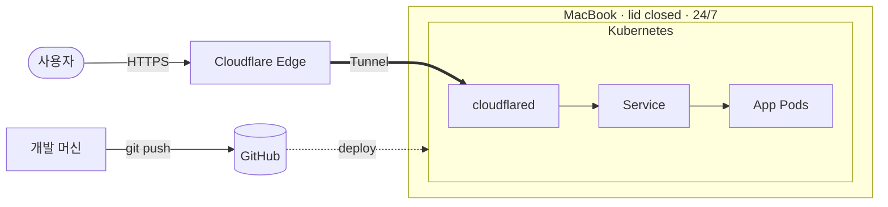

<div align="center">

# app-gongbang

**앱 공방** · 남는 맥북 한 대를 서버 삼아, 아이디어를 앱으로 만드는 공간


[Mission](#mission) · [Apps](#apps) · [Infrastructure](#infrastructure) · [Server Map](#server-map) · [Conventions](#conventions)

</div>

---

## Mission

```text
LAUNCH  [░░░░░░░░░░░░░░░░░░░░]  0 / 10   (0%)
```

> 완벽한 앱 하나보다, 세상에 나온 앱 열 개.


## Apps

| Slot | App | 한 줄 소개 | Status | Repo |
|:---:|---|---|:---:|---|
| `01` | — | — | ⚪ | — |
| `02` | — | — | ⚪ | — |
| `03` | — | — | ⚪ | — |
| `04` | — | — | ⚪ | — |
| `05` | — | — | ⚪ | — |
| `06` | — | — | ⚪ | — |
| `07` | — | — | ⚪ | — |
| `08` | — | — | ⚪ | — |
| `09` | — | — | ⚪ | — |
| `10` | — | — | ⚪ | — |

<sub>⚪ 빈 슬롯 · 🟡 기획 중 · 🔵 개발 중 · 🟢 런칭</sub>

## Infrastructure

맥북 한 대 위의 Kubernetes 클러스터에 모든 앱을 올리고, 외부 트래픽은 Cloudflare Tunnel로만 받는다.
공유기 포트포워딩도, 공인 IP도 필요 없다.



| Layer | 구성 | 비고 |
|---|---|---|
| Hardware | 남는 MacBook 1대 | 클램셸 모드, 상시 가동 |
| Orchestration | Kubernetes | 배포판 미정 |
| Ingress | Cloudflare Tunnel (`cloudflared`) | 아웃바운드 연결만 사용, 인바운드 포트 0개 |
| Source | GitHub `app-gongbang` | 앱 레포는 비공개 |
| Deploy | 미정 | 첫 앱 배포 때 결정 |

## Server Map

앱 하나 = 네임스페이스 하나 = 호스트네임 하나.

| Slot | App | Namespace | Hostname | Service |
|:---:|---|---|---|---|
| — | `<app>` | `<app>` | `<app>.<domain>` | `<app>:80` |

<sub>위 행은 형식 예시. 앱을 배포할 때마다 한 줄씩 추가한다.</sub>

> [!WARNING]
> 터널 토큰과 API 키는 이 문서에 적지 않는다. Kubernetes Secret으로만 관리한다.

## Conventions

**Repository**

| 레포 | 용도 |
|---|---|
| `<app>` | 앱 하나당 레포 하나, 이름은 kebab-case |
| `infra` | Kubernetes 매니페스트와 터널 설정 |
| `.github` | 이 문서 |

**Branch** · GitHub Flow

```text
main ──●────────●────────●──▶   항상 배포 가능한 상태
        \      /
         ●──●─┘                 <type>/<설명>  →  Squash and merge
```

**Commit** · Conventional Commits, 제목 50자 이내

| Type | 용도 |
|---|---|
| `feat` | 기능 추가 |
| `fix` | 버그 수정 |
| `refactor` | 동작 변화 없는 구조 개선 |
| `docs` | 문서 |
| `test` | 테스트 |
| `chore` | 빌드, 설정, 의존성 |

---

<div align="center">
<sub>since 2026.11 · built on a spare MacBook</sub>
</div>
