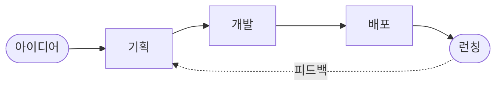
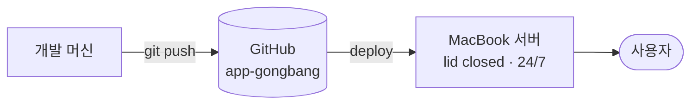

<div align="center">

# app-gongbang

**앱 공방** · 남는 맥북 한 대를 서버 삼아, 아이디어를 앱으로 만드는 공간


</div>

---

## Mission

```text
LAUNCH  [░░░░░░░░░░░░░░░░░░░░]  0 / 10   (0%)
```

> 완벽한 앱 하나보다, 세상에 나온 앱 열 개.

## Pipeline



## Apps

| Slot | App | 한 줄 소개 | Status | Repo |
|:---:|---|---|:---:|---|
| `01` | — | — | ⚪ | — |
| `02` | — | — | ⚪ | — |
| `03` | — | — | ⚪ | — |
| `04` | — | — | ⚪ | — |
| `05` | — | — | ⚪ | — |
| `06` | — | — | ⚪ | — |
| `07` | — | — | ⚪ | — |
| `08` | — | — | ⚪ | — |
| `09` | — | — | ⚪ | — |
| `10` | — | — | ⚪ | — |

<sub>⚪ 빈 슬롯 · 🟡 기획 중 · 🔵 개발 중 · 🟢 런칭</sub>

## Infrastructure



| 항목 | 내용 |
|---|---|
| Server | 남는 MacBook 1대 (클램셸 모드, 상시 가동) |
| Source | 이 조직의 비공개 레포 |
| Stack | 첫 앱에서 결정 |

---

<div align="center">
<sub>since 2026.11 · built on a spare MacBook</sub>
</div>
